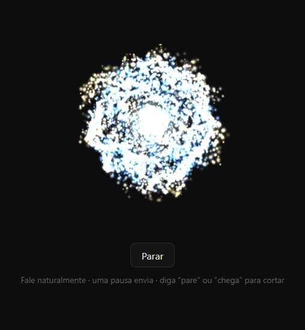

# 🎙 Modo Jarvis para o Claude Code

<p align="center">
  
</p>

**Converse com o Claude por voz.** Você fala, o Claude recebe como se você tivesse digitado e responde em voz alta, frase a frase, enquanto escreve, com uma orbe animada numa janelinha flutuante.


## Recursos

- **Fale em vez de digitar**: uma pausa envia o pedido; o que você fala enquanto o Claude trabalha entra na fila e vai quando ele terminar.
- **Resposta falada na hora**: a primeira frase é lida assim que chega, sem esperar a resposta inteira; blocos de código, tabelas e caminhos longos viram uma nota curta em vez de serem soletrados.
- **"Pare" ou "chega"** corta a fala e, se o Claude estiver trabalhando, interrompe o turno.
- **Aprovação por voz**: comandos curtos e edições na pasta do projeto são perguntados em voz alta; responda "sim" ou "não".
- **Sem chave de API**: por padrão usa o reconhecimento de voz e as vozes neurais do Microsoft Edge, que já vêm no Windows. OpenAI e ElevenLabs são opcionais.
- **Filtro de eco e de voz distante**: não confunde a própria fala com a sua nem reage a quem conversa ao fundo.

## Requisitos

- Windows 10 ou 11 com o Microsoft Edge (já vem instalado).
- Claude Code com suporte a mods (app desktop ou terminal).
- Microfone. Um fone de ouvido ajuda bastante a evitar eco.

Não precisa de Python nem de Node: o programa auxiliar vai empacotado em `bin/conversa-helper.exe`.

## Instalar

No prompt de uma sessão do Claude Code no terminal:

```
/plugin install modo-conversa --marketplace niuarque-br/mods-jarvis
```

Responda `y` para adicionar o marketplace e escolha onde instalar. Ou, de um shell:

```bash
claude plugin install modo-conversa --marketplace niuarque-br/mods-jarvis
```

Depois abra uma sessão nova ou rode `/reload-plugins`.

## Usar

1. Clique em **🎙 Modo Jarvis** acima do prompt, ou digite `/jarvis` (também vale `/conversa`).
2. Na primeira vez, a janelinha pede acesso ao microfone: permita.
3. Fale normalmente; uma pausa envia.
4. Clique em **Desligar** (ou `/jarvis` de novo) para sair.

| Você diz | O que acontece |
|---|---|
| qualquer pedido | vira o seu prompt para o Claude |
| **"pare"** ou **"chega"** | corta a fala; se o Claude estiver trabalhando, o turno para |
| **"sim"** / **"não"** | responde a um pedido de permissão feito em voz alta |

Comandos longos, arquivos fora da pasta do projeto e outras ferramentas sempre vão para a caixa de permissão normal do Claude.

## Opções

Pelo `/config` de um terminal (opções do plugin `modo-conversa`), ou pelo painel do mod [mods-config](https://github.com/niuarque-br/mods-config) no app desktop:

| Opção | Padrão | Para quê |
|---|---|---|
| Reconhecimento de voz | `browser` | `browser` usa o Edge sem chave; `openai` ou `elevenlabs` precisam de chave |
| Voz da resposta | `edge` | `edge` (sem chave), `openai`, `elevenlabs` ou `browser` (voz do Windows) |
| Nome da voz | `pt-BR-AntonioNeural` | Edge: `pt-BR-FranciscaNeural`, `pt-PT-DuarteNeural`…; OpenAI: `onyx`, `nova`…; ElevenLabs: id da voz |
| Velocidade da fala | `+0%` | por exemplo `+10%` ou `-5%` |
| Pausa que envia (ms) | `1200` | de 300 a 5000 |
| Filtro de voz distante | `45` | `0` desliga |
| Glossário do reconhecimento | termos de programação | ajuda a transcrição da OpenAI |
| Chave da OpenAI / ElevenLabs | — | guardadas como dado sensível; só o auxiliar as recebe |

Uma opção nova vale na próxima vez que o Modo Jarvis for ligado.

## Como funciona

```
Claude Code ── mod (hooks/register.tsx) ──┬── prompt, resposta em blocos falados, permissões
                                          │
                       stdin/stdout JSON  │
                                          ▼
              bin/conversa-helper.exe  (servidor local 127.0.0.1, token por sessão)
                                          │
                                          ▼
              Janelinha do Edge (--app): orbe, microfone, reconhecimento e voz
```

- O **mod** liga e desliga o modo, envia o que você falou como prompt, corta a resposta em frases e responde às permissões.
- O **auxiliar** abre a janelinha, sintetiza a voz (Edge, OpenAI ou ElevenLabs) e repassa os eventos da página ao mod. Escuta só em `127.0.0.1`, e comandos e eventos exigem o token da sessão.
- A **página** ouve o microfone, reconhece a fala, filtra eco e voz distante e toca as respostas.

## Desenvolvimento

| O quê | Comando |
|---|---|
| Testes do mod | `claude plugin validate .` e `claude plugin test .` |
| Testes do auxiliar (Python 3.11+) | `cd helper` e `python -m pytest -q` |
| Funções de voz da página | `node --test helper/web/tests/voicecore.test.mjs` |
| Gerar o exe | `powershell -ExecutionPolicy Bypass -File scripts/build-helper.ps1` |
| Ponta a ponta sem microfone | `.venv-build\Scripts\python.exe scripts\smoke.py` |

Sem o exe em `bin/`, o mod roda o auxiliar com `python -m conversa` a partir de `helper/` (precisa de `httpx` e `edge-tts`). Para testar sem instalar: `claude --plugin-dir <pasta do repositório>`.

## Créditos

- Orbe 3D feita com [three.js](https://threejs.org) (MIT), incluída em `helper/web/vendor/`.
- Vozes neurais via [edge-tts](https://github.com/rany2/edge-tts).

## Licença

[MIT](LICENSE) © 2026 Niuarque Batista
